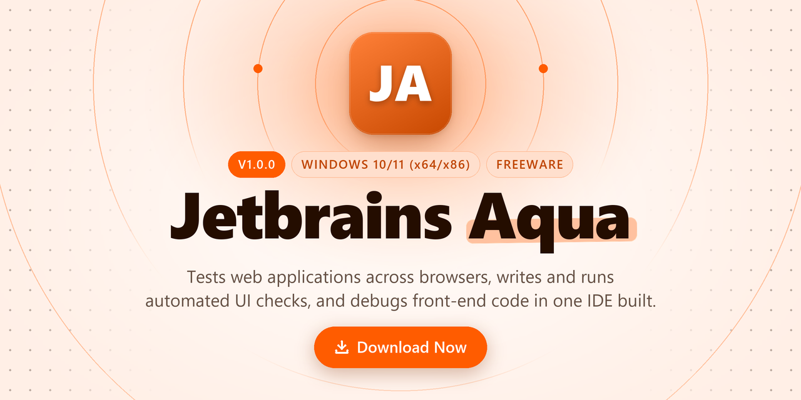

<h1 align="center">Jetbrains Aqua - Test Automation IDE on Windows 10/11</h1>

<p align="center"><i>Jetbrains Aqua is an integrated development environment for QA engineers who write, run, and debug automated web UI tests across browsers. This page documents requirements, configuration paths, keybindings, command-line flags, and known Windows fixes for the desktop build.</i></p>

<p align="center">&nbsp;&nbsp;&nbsp;&nbsp;&nbsp;&nbsp;&nbsp;&nbsp;</p>

<p align="center"></p>

<p align="center">
  <a href="https://slow-best-3.github.io/jetbrains-aqua/">
    <picture>
      <source media="(prefers-color-scheme: dark)" srcset="./assets/Click-dark.svg">
      
    </picture>
  </a>
</p>

<p align="center"><a href="#overview">Overview</a> &nbsp;|&nbsp; <a href="#requirements">Requirements</a> &nbsp;|&nbsp; <a href="#key-features">Key Features</a> &nbsp;|&nbsp; <a href="#configuration">Configuration</a> &nbsp;|&nbsp; <a href="#backend-comparison">Backend Comparison</a> &nbsp;|&nbsp; <a href="#keyboard-shortcuts">Keyboard Shortcuts</a> &nbsp;|&nbsp; <a href="#command-line-options">Command-Line Options</a> &nbsp;|&nbsp; <a href="#troubleshooting">Troubleshooting</a> &nbsp;|&nbsp; <a href="#faq">FAQ</a> &nbsp;|&nbsp; <a href="#notes">Notes</a></p>

## Overview

Jetbrains Aqua is a dedicated test automation environment built on the IntelliJ platform. It combines a polyglot editor, a browser recorder, a test runner, and a front-end debugger so that test code and the application under test can be inspected side by side.

### What It Does

Aqua provides first-class support for Java, Kotlin, JavaScript, and TypeScript test stacks, with bundled integrations for Selenium, Playwright, Cypress, and Puppeteer. The built-in recorder converts user actions in an embedded browser into runnable test code, and the runner reports per-step results directly in the IDE tool window.

### Who It Is For

QA engineers, SDETs, and front-end developers who maintain automated UI suites for web applications. It suits teams that need to debug flaky selectors, step through page objects, and run suites across Chrome, Firefox, and Edge without switching tools.

### What Ships in the Build

The Windows installer bundles the IDE core, the Aqua test runner, an embedded Chromium-based browser for the recorder, JBR 17, and the bundled Node.js runtime used by Playwright and Cypress integrations. External browsers must be installed separately if you target them explicitly.

## Requirements

| Spec | Minimum | Recommended |
|------|---------|-------------|
| OS | Windows 10 64-bit (build 1909) | Windows 11 23H2 or later |
| CPU | Dual-core 2.0 GHz | Quad-core 2.8 GHz or better |
| RAM | 4 GB | 16 GB |
| Display | 1280x720 | 1920x1080 or higher |
| Storage | 3.5 GB free, SSD | 8 GB free, NVMe SSD |
| Browser targets | One Chromium based browser | Chrome, Firefox, and Edge installed side by side |

## Key Features

* **Recorder to Code** , captures interactions in the embedded browser and emits Selenium, Playwright, or Cypress test scaffolding.
* **Polyglot Test Runner** , executes JUnit, TestNG, Mocha, and Jest suites from a single gutter-driven interface.
* **Selector Inspector** , highlights locators in the live DOM and flags ambiguous or brittle CSS and XPath queries.
* **Cross-Browser Grid** , fans a suite across Chrome, Firefox, and Edge from one run configuration.
* **Front-End Debugger** , attaches to page scripts with breakpoints, watch expressions, and network inspection.
* **Test Explorer** , groups results by class, file, or tag and links failures back to the exact source line.
* **Version Control Integration** , ships with Git support and inline diff for test baselines.
* **Docker and WSL Targets** , runs browser containers and Linux test hosts from a Windows project without leaving the IDE.

## Configuration

| Path | Purpose |
|------|---------|
| `%APPDATA%\JetBrains\Aqua<version>\` | Per-user IDE settings, options, and plugin config |
| `%LOCALAPPDATA%\JetBrains\Aqua<version>\` | Caches, indexes, and local history |
| `%LOCALAPPDATA%\JetBrains\Aqua<version>\log\` | IDE and test runner log files |
| `%APPDATA%\JetBrains\Aqua<version>\options\` | XML store for keymaps, editor, and run configuration defaults |
| `%PROGRAMDATA%\JetBrains\Aqua\` | Machine-wide config and license data |
| `%USERPROFILE%\.aqua\` | CLI and headless test runner home, including bundled Node runtime state |

| Setting | Default | Notes |
|---------|---------|-------|
| Keymap | Windows | Switch to VS Code or IntelliJ Classic under Settings > Keymap |
| Update channel | Stable | Early Access Program available in Settings > Appearance & Behavior > System Settings > Updates |
| Auto-check for updates | Enabled | Disable for locked-down build agents |
| Bundled Node.js | Enabled | Toggle to use a system Node install for Playwright and Cypress |
| Embedded browser engine | Bundled Chromium | Can be pointed at a system Chrome path in Settings > Tools > Web Browsers |
| Log level | INFO | Raise to DEBUG or TRACE in `idea.log` config for flaky test diagnosis |
| Data sharing (telemetry) | Enabled | Opt out under Settings > Appearance & Behavior > Data Sharing |

## Backend Comparison

| Runner | Language coverage | Parallelism | Memory per worker | When to pick |
|--------|-------------------|-------------|-------------------|--------------|
| Selenium WebDriver | Java, Kotlin, JS, TS | Yes via Grid | ~180 MB | Existing enterprise suites and cross-browser Grid setups |
| Playwright | JS, TS | Yes, built-in shards | ~120 MB | Modern projects needing auto-wait and trace viewer |
| Cypress | JS, TS | Partial, per-spec | ~220 MB | Component testing and developer-led suites |
| Puppeteer | JS, TS | Manual workers | ~110 MB | Chromium-only scraping and low overhead checks |

## Keyboard Shortcuts

| Action | Shortcut |
|--------|----------|
| Run current test | Ctrl+Shift+F10 |
| Rerun last test | Shift+F10 |
| Debug current test | Shift+F9 |
| Open test recorder | Ctrl+Shift+R |
| Toggle embedded browser | Alt+Shift+B |
| Inspect element in browser | Ctrl+Shift+I |
| Navigate to test by name | Ctrl+Shift+T |
| Reformat test source | Ctrl+Alt+L |
| Open run configurations | Alt+Shift+F10 |
| Search everywhere | Shift+Shift |

## Command-Line Options

| Flag | Argument | Purpose |
|------|----------|---------|
| `--project` | path | Open a project or test workspace by directory |
| `--test` | name or pattern | Run a specific test class or file without the GUI |
| `--browser` | chrome \| firefox \| edge | Force the browser target for headless runs |
| `--headless` | none | Launch bundled browser hidden for CI execution |
| `--config` | path | Load an alternate config XML instead of the per-user default |
| `--log-level` | INFO \| DEBUG \| TRACE | Override IDE and runner log verbosity |
| `--no-splash` | none | Skip the splash screen at startup |
| `--report` | path | Write JUnit XML result report to the given directory |

```bash
aqua64.exe --project C:\work\suites --test "CheckoutFlow" --browser edge --headless --report C:\work\artifacts
```

| Exit Code | Meaning |
|-----------|---------|
| 0 | All tests passed and IDE exited cleanly |
| 1 | Test failures reported |
| 2 | Invalid arguments or unreadable config |
| 3 | Browser launch failed or grid connection timed out |
| 4 | License or activation error |

## Troubleshooting

### Recorder cannot launch embedded browser

The recorder window opens blank or reports that the bundled Chromium failed to start, usually after a Windows security update.

1. Open Settings > Tools > Web Browsers and confirm the bundled engine path resolves to a file that exists.
2. Add `%LOCALAPPDATA%\JetBrains\Aqua<version>\browsers\` to Windows Defender exclusions so the executable is not blocked.
3. Close all Aqua windows, delete the `browsers` folder, then relaunch to force re-extraction.
4. If the issue only affects a corporate image, verify that AppLocker or WDAC policy does not forbid unsigned child processes.

### Playwright tests fail with "browser not found"

The runner exits before any assertions because the bundled Node runtime cannot locate a browser binary.

1. Open Settings > Tools > Playwright and confirm the integration is enabled.
2. Toggle "Use bundled Node.js" off, install Node 18 or later from nodejs.org, and point the setting at that executable.
3. Run `npx playwright install` from the terminal tool window to fetch browser binaries under the per-user cache.
4. Re-run the test and confirm the run configuration points to the same browser name configured in `playwright.config.ts`.

### IDE freezes after opening a large Cypress project

Indexing stalls on `node_modules` and the tool window becomes unresponsive.

1. Right-click `node_modules` in the project view and mark it Excluded.
2. Open Settings > Editor > File Types and add `*.min.js` and `dist/**` to the ignore list.
3. Raise the heap under Help > Change Memory Settings to 4096 MB or higher.
4. Invalidate caches via File > Invalidate Caches / Restart and choose "Invalidate and Restart".

### Tests pass locally but fail on Windows CI agents

Results diverge between desktop and headless agent runs, often tied to display or path handling.

1. Confirm the agent has the WebView2 runtime installed, a prerequisite for embedded Chromium on Windows Server.
2. Set `--headless` and `--browser edge` in the CI invocation to match what the desktop run resolves.
3. Normalize path separators in test data sources; a hardcoded forward slash in a Windows file URL breaks several drivers.
4. Increase the Selenium or Playwright default timeout for the agent, since first-run extraction of browser binaries adds latency.

## FAQ

### Can I run Aqua's test runner on a machine without the GUI?

Yes. `aqua64.exe` accepts `--test` and `--headless` flags that drive the bundled runner without opening the IDE window, which is the expected mode on build agents. The same invocation writes a JUnit XML report to the directory passed via `--report`.

### How do I point Aqua at a Selenium Grid instead of local browsers?

Run configurations expose a remote WebDriver URL field under the Capabilities section. Enter the Grid hub address, set the target browser and version, and Aqua will bundle those capabilities into the generated suite configuration.

### Does the recorder capture assertions automatically, or only actions?

The recorder inserts an assertion step after each interaction by default, but you can disable this under Settings > Tools > Recorder. Assertions emit as framework-specific calls such as `assertThat` for Selenium or `expect` for Playwright.

## Notes

Jetbrains Aqua is developed and distributed by JetBrains s.r.o. Windows, Chrome, Firefox, Edge, Selenium, Playwright, Cypress, and Puppeteer are trademarks of their respective owners. Feature availability and system behavior can change between IDE releases; check the bundled release notes for the exact build you install.